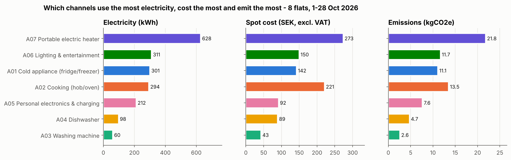
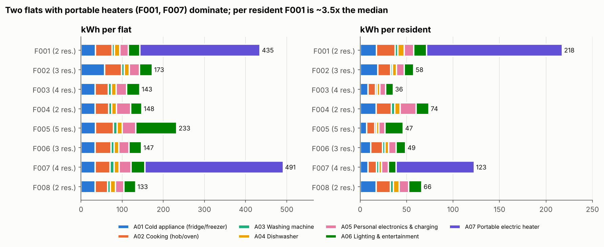
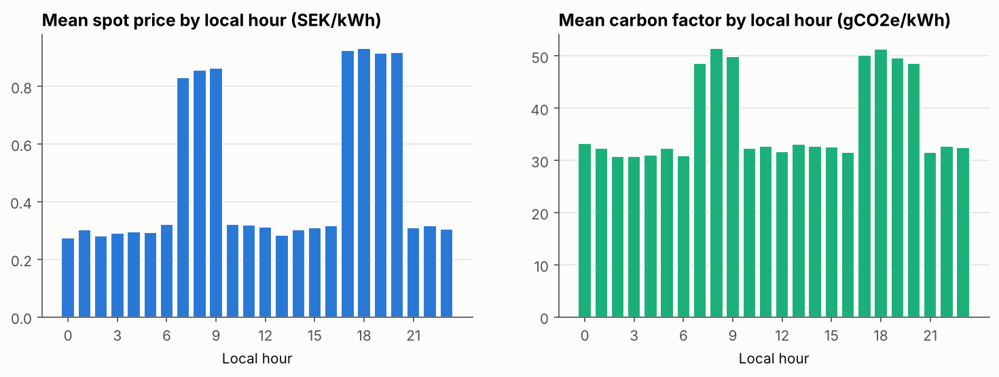
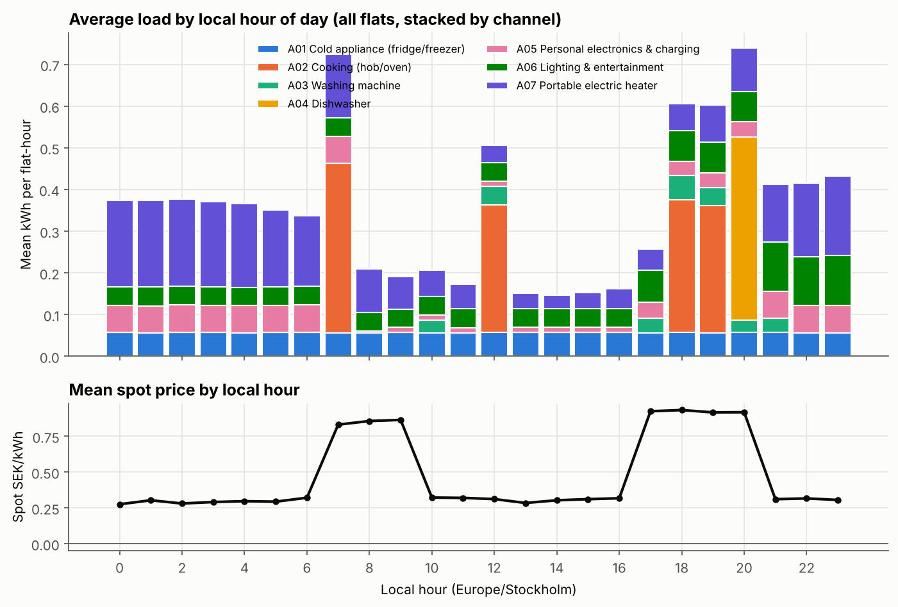
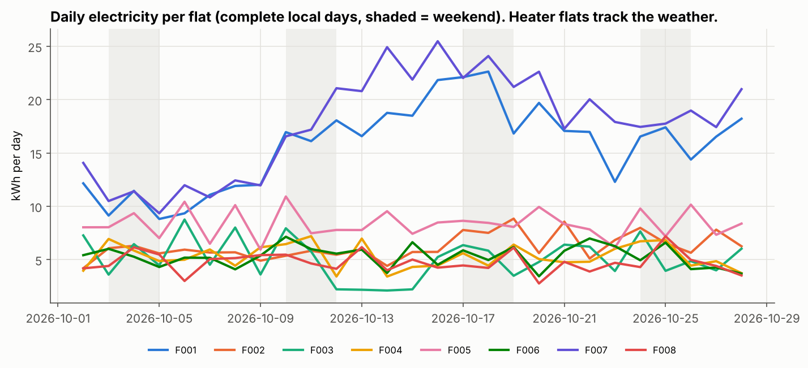
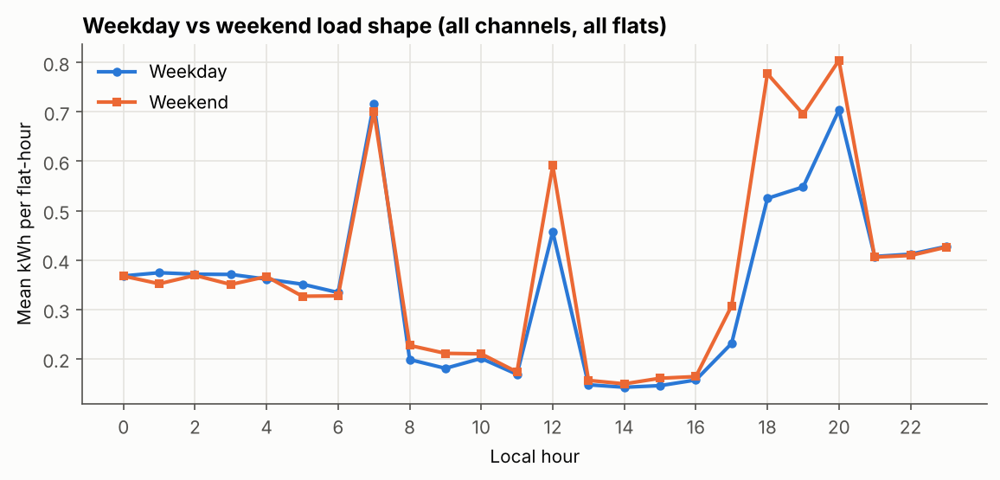
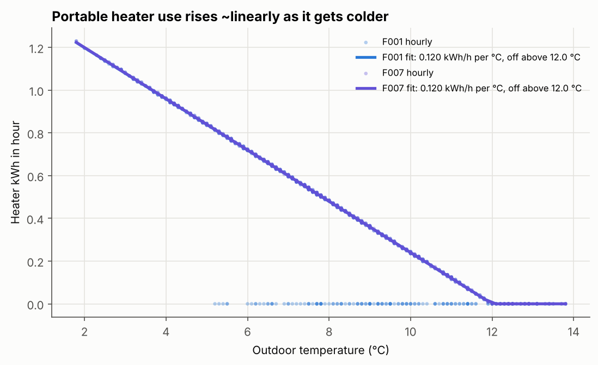
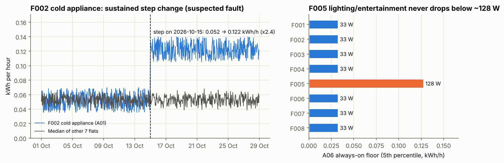
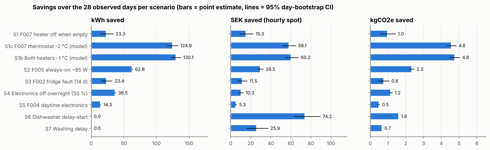

# Student-flat electricity: data cleaning, exploratory analysis and savings evaluation

**Dataset:** synthetic EnergySavingAI participant data: 8 fictional Swedish student flats, 25 residents, 7 appliance/circuit channels per flat, hourly, 1–28 Oct 2026 (672 h, SE3).
**Branch:** `mina`. **Pipeline:** `analysis/clean_data.py` → `analysis/validate.py` → `analysis/eda.py` (see *Reproducing*).
**Scope note:** The data are synthetic and are not calibrated to a real population. Every number below describes this dataset. None of it is evidence about real-world savings.

---

## 0. Executive summary

| Question | Answer from the data |
|---|---|
| What uses the most electricity? | **Portable electric heaters (A07): 628 kWh, 33 % of all electricity**, even though only **2 of 8 flats** (F001, F007) use one. Next: lighting & entertainment (A06, 16 %), cold appliances (A01, 16 %), cooking (A02, 15 %). |
| What costs students the most? | Heaters again (**273 SEK, 27 %** of spot cost), then **cooking (221 SEK, 22 %)**. Cooking costs more than its kWh share suggests because it happens at 07:00 and 18–19:00, when spot prices average 0.89 SEK/kWh. The rest of the day averages 0.30. |
| Where do flats differ? | F007 (491 kWh) and F001 (435 kWh) use **2.6–3.7×** what the six flats without heaters use (133–233 kWh). Per resident, F001 uses 218 kWh, **3.5×** the median of 62 kWh. |
| Biggest observed waste | (1) F007 runs its heater while the flat is empty: 23.3 kWh. F001 switches its heater off in 123 of 123 cold, empty hours; F007 in 0 of 55. (2) F005 has a **~95 W load that never switches off** on A06: 63 kWh. (3) **F002's fridge doubled its consumption (×2.4) overnight on 15 Oct** and stayed there: +23 kWh in 14 days. (4) F004 leaves electronics on all day: 14 kWh. |
| Biggest realistic savings | **kWh:** better heater habits in F001/F007 (125–148 kWh per 4 weeks, modelled), then the F005 always-on load (63 kWh, high confidence). **SEK under an hourly tariff:** delay-starting the dishwasher, which always starts at 20:00 in the price peak (74 SEK across 8 flats, −83 % of dishwasher spot cost, and also −1.6 kgCO2e). Under a fixed or monthly-average tariff, moving appliances to other hours saves **0 SEK**. Only using fewer kWh pays. |

All money figures are the **spot-energy component only, excl. VAT**. Energy tax, network fees, retailer markup and VAT are not in the data.

---

## 1. Data inventory and cleaning results

Full detail, with one row per correction, is in [`data_quality_report.md`](data_quality_report.md) and `data/processed/cleaning_log.csv` (718 entries). The six original files are not modified. Their hashes are recorded, and `validate.py` checks them against git HEAD.

### 1.1 Inventory

| File | Rows | Content |
|---|---:|---|
| energy_readings.csv | 37,715 | hourly kWh per flat × channel. Expected 37,632 slots (8 × 7 × 672), so the file has 83 more rows than slots |
| flats.csv | 8 | 25 residents; 56–95 m²; all SE3; one tariff id `T01`, with no lookup table |
| hourly_context.csv | 5,376 | outdoor/indoor temperature, occupants home |
| hourly_prices.csv | 672 | spot SEK/kWh (−0.15 to 2.72), carbon 14–65 gCO2e/kWh |

### 1.2 Key discovery that makes reliable repair possible

`reading_id` encodes its slot: `R` + (hour_index × 56 + (flat−1) × 7 + channel). This formula reproduces the timestamp of **every** row (0 disagreements), and the flat and appliance of 37,679 of 37,715 rows. I used it as independent evidence to repair identifiers. A repair was accepted only when two of the three ID fields agreed, the timestamp agreed, and the target slot was otherwise empty.

### 1.3 What was corrected, removed or left missing

| Issue | Rows | Treatment |
|---|---:|---|
| Legacy timestamp `YYYY/MM/DD HH:MM` | 79 | parsed as UTC |
| appliance_id lower-case or with spaces | 65 | normalised |
| appliance_id placeholder `F999-A01` | 12 | channel recovered from reading_id |
| flat_id contradicts appliance_id | 24 | flat_id corrected |
| Unit ` kwh ` / `Wh` | 70 / 141 | normalised / ÷1000 |
| Decimal comma `0,033` | 100 | converted |
| Exact duplicate rows | 100 | removed |
| Conflicting duplicates | 25 | 24 of 25 differ by exactly **+0.13 kWh** (a systematic offset). Kept the copy that matches neighbouring hours, which was the lower copy in 25 of 25. Worst-case effect: 3.25 kWh |
| Empty / `N/A` value | 380 / 110 | **left missing** |
| Negative kWh | 35 | set missing (no generation channel) |
| Spikes of 10.8–44.8 kWh/h | 25 | set missing. The valid maximum is 1.30 kWh/h, so any threshold between 1.5 and 10 gives the same result |
| Slot with no record | 42 | left missing. Nothing invented |
| Outdoor temp −99 sentinel | 20 | set missing |
| Occupants = 9 (> residents) | 12 | set missing |
| Occupants empty | 85 | left missing |
| Spot price empty | 8 h | left missing, so cost for those hours is missing |
| Negative spot price | 13 h | **kept** (all 00:00–05:59 local, on the nights of 10, 11, 12 and 23 Oct) |

**Result:** 37,040 of 37,632 slots are valid (**98.43 %**). The 592 missing slots are spread evenly: 57–104 per flat, 80–88 per channel, and the longest gap in one channel is 6 h.

### 1.4 Daylight-saving check (25 Oct)

Context timestamps use offsets +02:00 (4,616 rows) and +01:00 (760 rows). `timestamp_local` matches the IANA `Europe/Stockholm` conversion of `timestamp_utc` on all 5,376 rows. The repeated wall-clock hour is legitimate: 2026-10-25 00:00Z = 02:00+02:00 and 01:00Z = 02:00+01:00. All joins use UTC, and local hour and day are derived from UTC. As a result, local day 25 Oct has 25 hours, 1 Oct has 22 hours and 29 Oct has 2. Daily statistics use only complete local days (2–28 Oct), normalised to 24 h.

### 1.5 Join validation and the analytical table

`data/processed/analytical_table.csv` holds 37,632 rows, one per flat × channel × UTC hour. Each row is joined many-to-one to flats, context and prices, and pandas enforces that cardinality. **0 unmatched rows.** Indicator columns are kept: `energy_status`, `energy_missing`, `price_missing`, `occupancy_missing`, `outdoor_temp_missing`. Cost and CO2e are left missing (not 0) when kWh or price is missing.

### 1.6 Effect of the remaining gaps

- Estimated kWh hidden in missing slots (each channel's mean × its missing hours): **~31 kWh (1.6 %)**. Totals below are *observed*. Coverage-adjusted totals are in `eda_tables.md`, and **no ranking changes**.
- 17.2 kWh (0.9 %) fall in unpriced hours, so spot cost is understated by about 0.9 %.
- 38 kWh fall in hours with unknown occupancy. Those hours are excluded from occupancy analyses and are **not** counted as "empty".

### 1.7 Appliance types are inferred (assumption)

The dataset gives no appliance types. The labels below are inferred from load signatures and should be presented as assumptions in any product.

| Ch. | Inferred label | Signature in the data |
|---|---|---|
| A01 | Cold appliance | never zero; ~52 W around the clock in 7 of 8 flats |
| A02 | Cooking | 0.77 kWh one-hour events at 07, 12, 18–19 local; +32 % on weekends |
| A03 | Washing machine | 0.67 kWh one-hour events at varied hours; 88 events |
| A04 | Dishwasher | 0.89 kWh events; **all 108 start at exactly 20:00 local** |
| A05 | Personal electronics & charging | 4 W 08–17 h, ~65 W 21–08 h; rises with occupants home |
| A06 | Lighting & entertainment | 33 W constant floor + ~120 W in the evening |
| A07 | Portable heater | only F001/F007; hourly r with outdoor temperature = −0.88 / −1.00 |

---

## 2. Exploratory analysis

The figures are in `reports/figures/`. Every chart has a matching data table, either here or in [`eda_tables.md`](eda_tables.md).

### 2.1 Which channels use the most electricity (Q1)



| Channel | kWh | % kWh | Spot SEK | % SEK | kgCO2e | Effective SEK/kWh | Flats using |
|---|---:|---:|---:|---:|---:|---:|---:|
| A07 Portable heater | 628.3 | 33.0 | 273.5 | 27.1 | 21.8 | 0.44 | 2 |
| A06 Lighting & entertainment | 311.3 | 16.3 | 149.8 | 14.8 | 11.7 | 0.49 | 8 |
| A01 Cold appliance | 300.8 | 15.8 | 142.5 | 14.1 | 11.1 | 0.48 | 8 |
| A02 Cooking | 293.9 | 15.4 | 221.1 | 21.9 | 13.5 | **0.75** | 8 |
| A05 Electronics & charging | 212.1 | 11.1 | 91.9 | 9.1 | 7.6 | 0.44 | 8 |
| A04 Dishwasher | 97.6 | 5.1 | 89.4 | 8.8 | 4.7 | **0.92** | 8 |
| A03 Washing machine | 60.4 | 3.2 | 42.6 | 4.2 | 2.6 | 0.70 | 8 |
| **Total** | **1,904.5** | | **1,010.7** | | **73.1** | 0.54 | |

**Per flat:**
- In F001 and F007 the heater is **67–68 %** of all consumption.
- In flats without a heater, the cold appliance is the largest channel in F002, F003, F004 and F008 (23–33 %).
- Cooking is the largest in F006 (26 %).
- Lighting & entertainment is the largest in F005 (**43 %**), which is unusual (see 2.6).



### 2.2 Cost and emissions (Q2)

- The time-averaged spot price is **0.478 SEK/kWh**, but the flats paid a load-weighted **0.536 SEK/kWh** (+12 %), because consumption leans towards peak hours.
- Prices are bimodal. **07:00–09:59 and 17:00–20:59 local average 0.89 SEK/kWh; all other hours average 0.30.** These 7 peak hours are 29 % of the day but carry **38.6 % of kWh and 65.2 % of spot cost.**
- **The dishwasher has the highest effective price of any channel (0.92 SEK/kWh)**, because it always starts at 20:00. Cooking pays 0.75. Both pay about 1.5–1.9× the average.
- Carbon follows the same daily shape (Spearman ρ price vs carbon = 0.58). Peak hours average 49–52 g/kWh against 31–33 g/kWh off-peak. So **moving load out of peak hours cuts cost and CO2e together** in this dataset.
- The heater's effective price is low (0.44) because 39–46 % of its energy is used overnight, when power is cheap.



### 2.3 Daily, hourly, overnight and weekday/weekend patterns (Q3)



- **Hourly:** the load peaks at **20:00 local** (dishwasher plus evening use), with further peaks at 07:00 (breakfast) and 18–19:00 (dinner). These line up with the price peaks. The lowest load is 13–15:00.
- **Overnight (00:00–05:59):** this window holds **25.6 %** of all kWh; that is 36 % in F001 and 32 % in F007 (heaters) and 16–19 % elsewhere. Excluding the cold appliance and heater, overnight discretionary load is 0.52–0.66 kWh per night in seven flats, but **1.30 kWh per night in F005**.
- **Daily:** heater flats follow the weather. Their daily use rose from ~10–12 kWh in the mild first week to 21–25 kWh around 13–18 Oct. Non-heater flats stay at 4–9 kWh a day.
- **Weekday vs weekend:** most flats use 7–28 % more at weekends, driven by cooking (+32 %) and electronics (+14 %). F007 is the exception (−5 %), because its heater dominates.
- **Vacancy:** F003 was empty for three whole days (13–15 Oct), and its use fell to **2.18 kWh/day**: cold appliance 1.29, the 33 W A06 floor 0.79, electronics standby 0.10.




### 2.4 Relationships with occupancy, temperature, price and carbon (Q4)

These are Spearman correlations over complete flat-hours. "Non-heater kWh" excludes A07.

| Pair | All flats | Heater flats | Non-heater flats |
|---|---:|---:|---:|
| total kWh vs occupants home | 0.41 | 0.51 | 0.47 |
| total kWh vs outdoor temp | −0.27 | **−0.76** | −0.20 |
| non-heater kWh vs outdoor temp | −0.23 | −0.35 | −0.20 |
| total kWh vs indoor temp | 0.20 | 0.11 | −0.03 |
| total kWh vs spot price | 0.07 | −0.01 | 0.07 |
| total kWh vs carbon | 0.01 | −0.19 | 0.03 |

- **Occupancy is the main driver of non-heater use.** An empty flat uses 0.148 kWh/h; with someone home it uses 0.24–0.34 kWh/h. At flat level, non-heater kWh correlates with resident count at r = 0.72, but less than proportionally: 2-resident flats use 66–74 kWh per resident and 4–5-resident flats 36–47, because fridges and base loads are shared.
- **Heater use is almost a deterministic function of outdoor temperature:** 0.12 kWh/h for every °C below **12.0 °C**, with the same curve in both flats.
- **Load barely responds to price** (ρ = 0.07). There is no sign of price-aware behaviour, which is the opportunity in section 3.
- **Indoor temperature:** six flats, and F001, sit at 20.5 ± 0.36 °C. **F007 sits at 22.5 °C** in every hour, whether its heater is on or off. The heater curve in F007 is identical to F001's, so the dataset **cannot** show that the heater causes the extra 2 °C. That limits how confident we can be about a thermostat recommendation.



### 2.5 Flat comparison (Q5)

| Flat | Res. | m² | kWh | kWh/res. | kWh/res. excl. heater | kWh/m² | Spot SEK | SEK/res. | Indoor °C |
|---|---:|---:|---:|---:|---:|---:|---:|---:|---:|
| F001 | 2 | 56 | 435.2 | **217.6** | 71.5 | 7.77 | 210.8 | 105.4 | 20.5 |
| F002 | 3 | 69 | 173.4 | 57.8 | 57.8 | 2.51 | 99.6 | 33.2 | 20.5 |
| F003 | 4 | 82 | 143.1 | 35.8 | 35.8 | 1.75 | 82.6 | 20.6 | 20.5 |
| F004 | 2 | 56 | 148.1 | 74.1 | **74.1** | 2.65 | 80.2 | 40.1 | 20.5 |
| F005 | 5 | 95 | 232.9 | 46.6 | 46.6 | 2.45 | 135.5 | 27.1 | 20.5 |
| F006 | 3 | 69 | 147.4 | 49.1 | 49.1 | 2.14 | 82.2 | 27.4 | 20.5 |
| F007 | 4 | 82 | 491.5 | 122.9 | 38.8 | 5.99 | 243.6 | 60.9 | **22.5** |
| F008 | 2 | 56 | 132.9 | 66.4 | 66.4 | 2.37 | 76.2 | 38.1 | 20.5 |

**Fair comparison needs context.** Once the heater is excluded and household size is taken into account, F001 and F007 are not unusual. **F004** has the highest per-resident use without a heater, because its electronics stay on all day (2.6). **F005** is the highest per flat without a heater, because of its always-on load. Comparing flats needs residents, area and heater status together. kWh per resident on its own is misleading.

### 2.6 Unusual patterns, standby waste and suspected equipment faults (Q6)



| Finding | Evidence | Likely cause | Confidence |
|---|---|---|---|
| **F002 cold appliance step change** | 0.052 → 0.122 kWh/h at 2026-10-15 02:00 local (×2.36). All 332 hours after the step exceed the pre-step maximum (0.070). The other 7 flats stay at 0.053. | **Equipment fault** (door seal, thermostat, defrost, compressor). The step is sustained and noisy-realistic, so it is unlike corrupt readings, which are isolated spikes. | High that it is real. Cause unknown. |
| **F005 always-on ~95 W** | A06 5th-percentile floor of 128 W against 33 W in all 7 other flats, for all 4 weeks. | Something left on: light, TV/console in standby, decorative or aquarium lighting. | High that it exists. Device unknown. |
| **F004 electronics on all day** | A05 09–16 h averages 69 W against 4 W in all 7 other flats. It still draws 42 W when the flat is empty. | PC, console or monitor left running. | High. |
| **F007 heats an empty flat** | 56 h / 23.3 kWh with 0 occupants. In cold, empty hours: F001 off 123/123, F007 off 0/55. | Heater left on when leaving. | High (observed). |
| **F007 22.5 °C** | 2 °C above every other flat, constant. | Thermostat or comfort preference. | Medium. Link to heater not demonstrable. |
| Fleet-wide 33 W A06 floor | Present in every flat, including during F003's vacancy. 177 kWh over 28 days across 8 flats. | Router, standby or night light. Possibly necessary. | Low that it is avoidable. |
| Dishwasher always at 20:00 | 108/108 events. | Habit or a fixed programme. | High. |

Corrupt readings (negatives, 10–45 kWh spikes, the +0.13 duplicate offset) were isolated single values and were removed in cleaning. The four equipment and behaviour findings above are **sustained regime changes or persistent levels**, which is why they are classified as real.

### 2.7 Can students save by moving usage to cheaper hours? (Q7)

Only **A03 + A04 = 8.3 % of kWh** are plausibly shiftable. Cooking, lighting, the fridge and heating are not.

Simulation method: each observed event is moved to the cheapest hour in its allowed window. Day-ahead prices are known by the previous afternoon, so this is achievable in practice. kWh per cycle stays the same, and cycles are only delayed, never brought earlier.

| Scenario | Events | Baseline SEK | After SEK | Saving (hourly tariff) | 95 % CI | CO2e change | Saving (fixed / monthly-avg tariff) |
|---|---:|---:|---:|---:|---:|---:|---:|
| Dishwasher: delay-start from 20:00 to cheapest hour ≤ 07:00 | 108 | 89.41 | 15.26 | **74.15 SEK (−83 %)** | 63.5–89.2 | −1.60 kg | **0 SEK** |
| Washing: delay ≤ 12 h, start 07:00–21:59 only | 88 | 42.58 | 16.68 | 25.90 SEK (−61 %) | 16.1–37.0 | −0.65 kg | **0 SEK** |

- That is about **0.69 SEK per dishwasher cycle**, or about 9 SEK per flat per 4 weeks. The percentage is large but the amount in SEK is small, because spot prices in this dataset are low.
- **Theoretical upper bound:** if *every* kWh were bought at that day's cheapest hour, spot cost would fall by 726 SEK (72 %). That is not achievable for cooking, lighting or heating, and is shown only for scale.
- **Tariff dependence is decisive.** Many students pay a fixed price, a monthly-average spot price, or have electricity included in their rent. For them, moving appliances to other hours saves nothing. It still cuts CO2e here, because peak hours are also higher-carbon.

---

## 3. Evaluating savings: baseline, counterfactual, uncertainty

### 3.1 Method

- **Baseline:** the *observed* cleaned kWh of the affected flat, channel and hours over the 28 days. Missing slots are not filled.
- **Counterfactual:** the baseline with an explicit rule applied hour by hour, as listed per scenario. This is a **simulation**.
- **Savings:** ΔkWh, plus SEK under two tariff views (hourly spot = Σ ΔkWh × hourly price; monthly-average spot = ΔkWh × 0.478), plus kgCO2e = Σ ΔkWh × hourly factor / 1000.
- **Uncertainty:** 95 % intervals from a day-block bootstrap (2,000 resamples of the 28 days). These capture day-to-day variability only, **not** assumption risk, which is rated separately.

### 3.2 Results (28 days, spot energy only, excl. VAT)



| # | Opportunity | Baseline kWh | ΔkWh (95 % CI) | Δ SEK hourly | Δ SEK monthly-avg | ΔkgCO2e | Status |
|---|---|---:|---:|---:|---:|---:|---|
| S1 | F007 heater off when the flat is empty | 336.2 | **23.3** (13.5–33.5) | 15.31 | 11.12 | 0.97 | baseline **observed**; counterfactual simple |
| S1c | F007 heater thermostat −2 °C to peer 20.5 °C (occupied hours) | 336.2 | 124.9 (116.6–132.7) | 58.10 | 59.66 | 4.57 | **simulated, low confidence** |
| S1b | Both heater flats −1 °C (sensitivity) | 628.3 | 130.1 (122.6–137.2) | 60.24 | 62.14 | 4.76 | **simulated, low confidence** |
| S2 | F005: remove the ~95 W always-on load | 99.5 | **62.8** (62.3–63.3) | 29.46 | 30.00 | 2.34 | baseline observed; counterfactual simulated |
| S3 | F002: repair the fridge (14 days after the step only) | 40.5 | 23.4 (14.8–31.9) | 11.54 | 11.16 | 0.77 | baseline observed; repaired level = pre-fault level |
| S4 | All flats: PCs/consoles off 00–06 h (10 W allowance, 50 % adoption) | 86.0 | 36.5 (35.5–37.3) | 10.32 | 17.42 | 1.16 | **simulated** |
| S5 | F004: electronics off 08–17 h (to peer level) | 15.3 | 14.3 (14.0–14.6) | 5.29 | 6.83 | 0.49 | baseline observed; counterfactual simulated |
| S6 | Dishwasher delay-start (all flats) | 97.6 | 0 | **74.15** (63.5–89.2) | **0** | 1.60 | simulated; **hourly tariff only** |
| S7 | Washing-machine delay (all flats) | 60.4 | 0 | 25.90 (16.1–37.0) | **0** | 0.65 | simulated; **hourly tariff only** |

S1b and S1c overlap, so they must not be added together. S1 and S1c are defined so that they can be added: S1c counts only occupied hours.

### 3.3 Assumptions and limitations per opportunity

- **S1 / S1c / S1b (heaters):** S1 is close to an observation: F001's behaviour shows that switching off when leaving is practical, and district heating keeps the base temperature. Rebound is possible: a cold flat may need extra heat on return, and this is not modelled. S1c/S1b rely on a degree-hour model, and **cannot be verified from this dataset**, because F001 and F007 have identical heater curves at different indoor temperatures. Treat them as "what if" values for a calculator, not as findings. Heater savings are **strongly seasonal**: October averaged 7.8 °C outdoors (range 1.8–13.8 °C), and each °C colder adds 0.12 kWh/h while the heater is on. Four autumn weeks cannot give annual savings, and the model is not valid below the observed 1.8 °C.
- **S2:** the *excess* is measured. Which device causes it is not identifiable from hourly data. If the load persists all year it is ≈ 0.095 × 8,760 ≈ **830 kWh/year**. That is an extrapolation of a constant load, and it is valued at whatever price applies.
- **S3:** a fault like this would continue until repaired (≈ 0.070 × 8,760 ≈ 615 kWh/year if never fixed). The repair cost, and who pays it (landlord or student), is outside the data. This is a **maintenance alert**, not a behaviour change.
- **S4:** the device type is inferred. Phones need about 10–20 Wh per night, which is why the allowance is 10 W. The 50 % adoption rate is an assumption. The SEK saving is lower under an hourly tariff (10.3) than under a monthly-average one (17.4), because the night hours affected are cheap.
- **S6/S7:** these need an hourly-priced contract **and** an appliance with delay-start, and they assume a noise-free or permitted overnight run. Under a fixed, monthly-average or rent-included contract the saving is **0 SEK**, though the CO2e reduction remains.
- **All scenarios:** spot component only. Variable per-kWh charges such as energy tax, network transfer fee and VAT would **increase** the SEK value of kWh reductions (S1–S5) but **not** of shifts (S6–S7). The data supply none of these charges, so a calculator needs them as stated, user-supplied parameters. Fixed fees do not change. The data are synthetic: suitable for a demo, not as evidence.

### 3.4 What is observed, what is simulated, and what cannot be verified

| Category | Items |
|---|---|
| **Observed** | all consumption, cost and CO2e totals; channel and flat rankings; peak-hour cost share; F002 step; F005 floor; F004 daytime load; F007 empty-flat heating; F001 switch-off behaviour; F003 vacancy load |
| **Simulated (counterfactual rule + data)** | S1–S7 savings values |
| **Not verifiable from this dataset** | appliance identities; whether the F007 heater causes 22.5 °C; comfort effects; post-repair fridge level; adoption/compliance; each student's tariff; annual or seasonal totals; rebound effects; full-bill savings |

---

## 4. Evidence-based student saving opportunities (ranked)

1. **Switch portable heaters off when leaving, and avoid overheating** (F007; also relevant to F001). The heater is 33 % of fleet kWh and 67–68 % of each heater flat's use. Observed avoidable use: **23 kWh / 4 weeks**, with up to 125 kWh more modelled if the thermostat matches peers. This is the largest kWh lever, and the value of reductions holds under every tariff. F001 already does this, so it is realistic.
2. **Find and kill the always-on load in F005.** **63 kWh / 4 weeks** (−63 % of that channel), constant, high confidence, any tariff. This generalises to an "always-on load detector": compare a flat's overnight minimum with its peers.
3. **Report the faulty fridge in F002.** **+23 kWh in 14 days** so far, ×2.4 normal. Detectable automatically within hours of the step.
4. **Delay-start the dishwasher out of the 17–21 h price peak** (all flats). **−83 % of dishwasher spot cost (74 SEK fleet-wide) and −1.6 kgCO2e**, but **only on an hourly tariff**. For everyone else, the message is the carbon benefit.
5. **Turn off electronics when away or asleep** (F004 by day: 14 kWh; all flats at night at 50 % adoption: 36 kWh). Moderate kWh, and the device identity is uncertain.

---

## 5. Implications for the planned AI chatbot and savings calculator

**Findings that are robust enough to power features:**

| Feature idea | Supported by | Inputs needed |
|---|---|---|
| Channel and flat breakdown ("what uses my electricity") | 2.1, 2.5 | cleaned table. Labels shown as *inferred* |
| Peak-hour warning ("07–10 and 17–21 cost about 3× more") | 2.2: 38.6 % of kWh → 65.2 % of cost | prices + the user's tariff type |
| Always-on / standby detector | F005 128 W vs 33 W peers; F003 vacancy 2.18 kWh/day | overnight or vacancy minimum vs peers |
| Fault detector (step change) | F002 ×2.36 sustained | per-channel changepoint test; alert after ~24 h |
| Empty-flat heating alert | F007 23.3 kWh; F001 benchmark | occupancy (do not treat unknown as 0) |
| Shift calculator | S6/S7 | **must ask the tariff type first**: hourly → SEK + CO2e; fixed/monthly/included → CO2e only |
| Savings calculator core | §3.1 | `ΔkWh × (spot + user-supplied per-kWh adders)`; CO2e from the destination hour |

**Guardrails for the chatbot:**
- Never present S1b/S1c thermostat savings as measured.
- Never annualise heater savings from October data.
- Always state that appliance types are inferred, and that SEK figures exclude taxes and fees unless the user supplies them.
- Treat missing data as unknown, never as zero.
- Do not claim appliance-level identification from hourly data.

**Not yet supported:** a sustainability score, comfort-aware heating advice, full-bill estimates, and per-device recommendations.

---

## Reproducing

```bash
pip install -r analysis/requirements.txt
python analysis/clean_data.py   # writes data/processed/* and reports/data_quality_report.md
python analysis/validate.py     # 30 checks; exit code 1 on failure
python analysis/eda.py          # writes reports/figures/*, reports/eda_results.json, reports/eda_tables.md
```

Every number in this report comes from `reports/eda_results.json`, `reports/eda_tables.md` or `data/processed/cleaning_summary.json`. The bootstrap uses a fixed seed (20261107).
